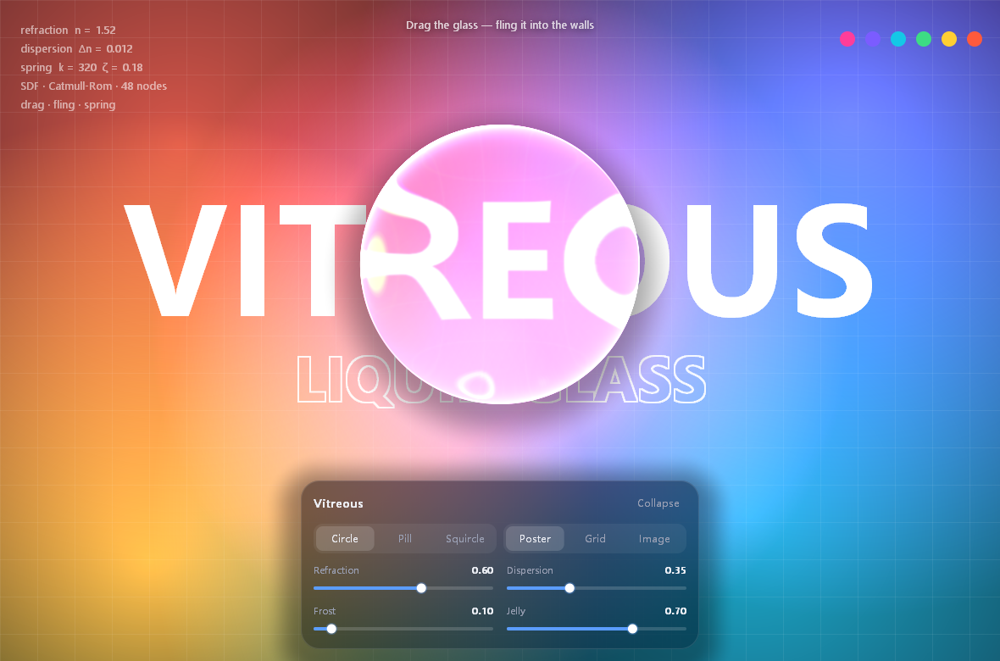
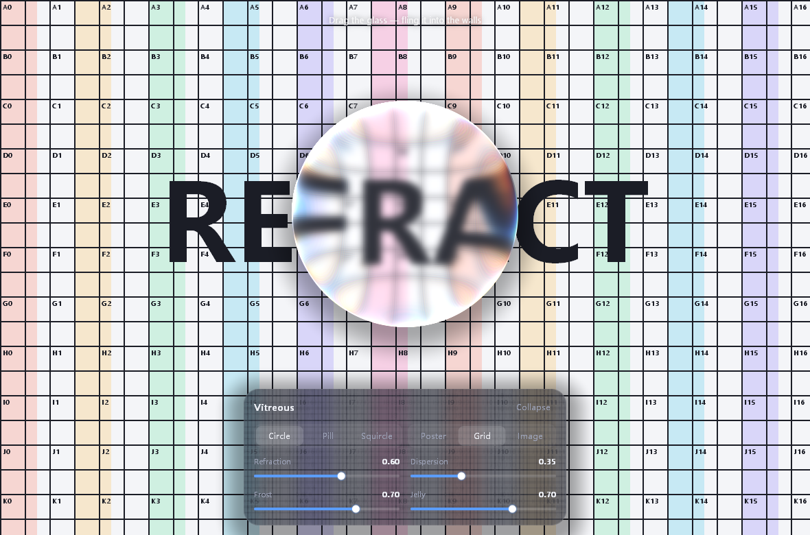

# Vitreous

一个原生 C 实现的液态玻璃材质演示：Win32 窗口 + WGL OpenGL 3.3 core，GLSL 330 片元着色器
逐像素算出玻璃的折射、色散、磨砂与高光，界面部分用 GDI 光栅化后当纹理合成。
单文件、无第三方依赖、不需要 Rust 工具链或任何下载。

界面全部英文：标题、面板、提示、海报与网格文字都是英文。





## 实现内容

- **玻璃形状**：48 个极径节点 + Catmull-Rom 插值，Circle / Pill / Squircle 三种基形；
  片元里用极坐标 SDF 求距离与法线，倒角处折射偏移、法线高光、边缘亮线、内阴影、外投影，
  以及 R/G/B 三通道分别偏移采样得到的色散。
- **物理**：固定步长 1/240 的弹簧-阻尼拖拽（K=520, ζ=0.8），自由飞行阻尼、撞墙恢复系数 0.55；
  速度驱动的果冻形变（lap 平滑 + 均值归零），按下时整体回弹放大到 1.07。
- **磨砂**：可分离高斯模糊，两遍 ping-pong（11×11 采样），σ = frost × 7 px；
  玻璃着色器再按 `uFrostMix` 在清晰背景与模糊背景之间插值。
- **背景**：Poster（加色径向光斑 + 网格 + `VITREOUS` 大标题 + 图例）、Grid（色带 + 坐标标签 +
  大号 `REFRACT`）、以及通过 WIC 解码的任意图片（cover 填充）。
- **底部面板**：24px 背景模糊（13 taps 近似）+ 1.4 饱和度 + 62% 的 `rgb(22,24,34)` + 1px 内描边 + 投影；
  标题、Collapse/Expand、两组分段控件、四个滑块的排版按内容盒模型计算
  （content-box 440×171，外框 470×199 @ dpr 1）。
- **交互**：按住玻璃拖动 / 甩出撞墙、点击切换形状与背景、滑块实时调参、收起面板、
  上传图片（文件对话框）、提示文字首次拖动后 0.6 s 淡出、窗口缩放与高 DPI 自适应。

## 构建

需要 MinGW-w64 的 gcc（已在 gcc 16.1.0 上验证）：

```bat
build.bat
```

或手动：

```bat
gcc -std=c11 -O2 -Wall -Wextra -Wno-unused-parameter ^
    -D_WIN32_WINNT=0x0A00 -DWINVER=0x0A00 ^
    vitreous.c -o vitreous.exe ^
    -lopengl32 -lgdi32 -luser32 -lole32 -luuid -lshell32 -lcomdlg32 ^
    -mwindows -lm
```

MSYS / Git Bash 下用 `./build.sh`。产物为单个 `vitreous.exe`，无运行时依赖。

## 运行

```bat
vitreous.exe
```

默认 1180×780 可调窗口；拖动玻璃、甩出去撞墙。面板里的滑块分别是
Refraction、Dispersion、Frost、Jelly（0..1）。

## 命令行参数

| 参数 | 说明 |
| --- | --- |
| `--shot out.bmp` | 离屏渲染一帧并保存 24 位 BMP 后退出（截图 / 回归） |
| `--size WxH` | 渲染尺寸（默认 1180x780） |
| `--dpr X` | 设备像素比（默认取系统 DPI，上限 2） |
| `--ms N` | shot 模式先跑 N 毫秒物理（默认 600） |
| `--shape 0\|1\|2` | circle / pill / squircle（也接受名字） |
| `--bg 0\|1\|2` | poster / grid / image（也接受名字） |
| `--collapse` | 启动时面板收起 |
| `--values r,d,f,j` | 折射、色散、磨砂、Q 弹四个初值 |
| `--image PATH` | 启动时载入背景图片（png/jpg/bmp/webp） |
| `--click X,Y` | 在客户区坐标处模拟一次点击 |
| `--drag X0,Y0,X1,Y1` | 模拟一次拖拽 |
| `--log` | 日志写入 `vitreous.log` |

示例：

```bat
vitreous.exe --shot grid.bmp --bg grid --ms 1500
vitreous.exe --shot hi.bmp --dpr 1.5 --size 1180x780 --shape pill
```

## 代码结构（vitreous.c，约 2700 行）

| 区块 | 内容 |
| --- | --- |
| 画布 | 32 位 top-down DIB，自带 alpha 混合、圆角矩形、圆、盒子模糊 |
| 文本 | GDI 字体缓存（Segoe UI）+ 白色字形掩码，支持描边 |
| 图片 | WIC 解码为 BGRA，`load_image_wic` |
| 物理 | 48 节点极径、`step_physics` |
| 布局 | `layout_update` 按内容盒模型计算面板与各控件矩形 |
| 界面 | `ui_rebuild` 把面板内容画进透明画布再上传纹理 |
| 渲染 | 玻璃全屏三角形 → 场景 FBO；磨砂两遍高斯 → blur FBO；面板 pass 做 backdrop 模糊/染色/描边并与 UI 纹理合成 |
| 窗口 | WGL 3.3 core 上下文、DPI 感知、鼠标/键盘、resize |
| 工具 | `--shot` 离屏 BMP、`--click/--drag` 合成事件、日志 |

## 渲染细节与限制

- 字体：GDI 最粗到 700，大标题的笔画比可变字体的 900 略细。
- 面板背景模糊固定 13 taps 近似，极细密的网格线透过面板时仍略清晰。
- 提示文字的 `text-shadow` 用 alpha 通道三次盒式模糊近似（半径 4*dpr）。
- 玻璃投影按 10px 偏移 + 44px 平滑衰减近似。

玻璃内部取样色差 ≤5/255（dpr 1 下与参考渲染对比），面板几何偏差 ≤1 px。
